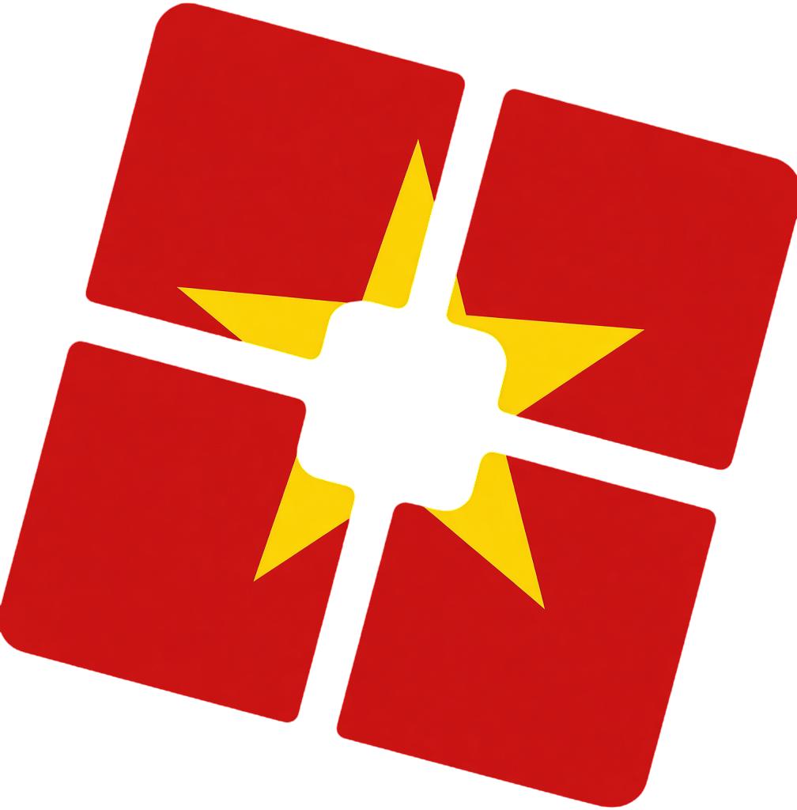
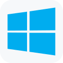

<p align="center">
<a href="https://xeonstrapp.pages.dev/">

</a>
</p>

<h1 align="center"><b>Xeonstrap</b></h1>

<p align="center">
  <b>Customize and launch Roblox your way.</b><br/>
  A free and open source bootstrapper for Roblox. Manage FastFlags, appearance,
  integrations and the whole launch process — on Windows, macOS, Linux and Android.
</p>

<div align="center">

[![Latest Release][shield-repo-latest]][repo-latest]
[![Total Downloads][shield-repo-total]][repo-releases]
[![Latest Downloads][shield-repo-downloads]][repo-latest]
[![Stars][shield-repo-stars]][repo-stargazers]
[![License][shield-license]][link-license]
[![Builds][shield-actions-build]][repo-actions]
[![Localized][shield-crowdin-localized]][crowdin-project]
[![Discord][shield-discord-server]][discord-invite]

</div>

<p align="center">
  <picture><source media="(prefers-color-scheme: dark)" srcset="assets/readme/windows-tile-dark.svg"></picture>
    
  
    
  
    
  <picture><source media="(prefers-color-scheme: dark)" srcset="assets/readme/macos-dark.svg"></picture>
</p>

<p align="center">
  <a href="#installation">Install</a> ·
  <a href="#features">Features</a> ·
  <a href="#faq">FAQ</a> ·
  <a href="#building">Building</a> ·
  <a href="#license">License</a> ·
  <a href="https://github.com/XeonCorporationOfficial/Xeonstrap/releases/latest">Releases</a> ·
  <a href="https://xeonstrapp.pages.dev/">Website</a> ·
  <a href="https://discord.gg/wVFyshHUHh">Discord</a>
</p>

<h3 align="center">Install in one command</h3>

**Windows** (PowerShell 5.1 or newer)

```powershell
irm https://xeonstrapp.pages.dev/quick-install | iex
```

**Linux and macOS**

```bash
curl -fsSL https://xeonstrapp.pages.dev/install.sh | sh
```

<h5 align="center">
  Leave a star if you like the project! ⭐️
</h5>

---

> [!IMPORTANT]
> Xeonstrap is cross platform and supports **Windows 10 and above**, **macOS**, **Linux**, and **Android**.

> [!WARNING]
> Xeonstrap is not an exploit and never will be. We are not considered an exploit. We are here to give users more freedom, features, and support for Roblox.
>
> As of Xeonstrap Version `1.0.0.0`, Multi-Instance Launching has been removed from the app and will not be added back in the future.

## Features

Everything below lives in one sidebar. The [website](https://xeonstrapp.pages.dev/#menu) has an interactive rebuild of that menu, so you can click through it before installing anything.

- 🎛️ **FastFlags** — a settings panel for the flags you actually use, plus a full JSON editor with an allowlist so you can see what changed.
- 🚀 **Deployment** — choose what happens on launch, keep caches clean, and control CPU and memory use while Roblox runs.
- 🎨 **Appearance** — accent colour, background image, window roundness, snow, custom themes and a bootstrapper you can restyle.
- 🔔 **Integrations** — activity tracking, server location, friend notifications and a Discord Rich Presence you can shape yourself.
- 🧩 **Mods and files** — manage file mods for the client, browse community mods and explore the files in your Roblox install.
- ☕ **Sober on Linux** — on Linux and NixOS, Xeonstrap manages Sober through Flatpak and applies your settings around it.
- 📦 **Manager and classic clients** — keep several installs side by side, update them, and launch classic clients straight from the app.
- 🧱 **Extensions** — add community extensions to Xeonstrap, or read the source and write your own checks.

## Installation

1. Download the [latest version](https://github.com/XeonCorporationOfficial/Xeonstrap/releases/latest).
2. Run the `.exe` and complete the setup.
3. Launch Xeonstrap.
4. Enjoy a simpler Roblox!

<details>
  <summary><picture><source media="(prefers-color-scheme: dark)" srcset="assets/readme/android-setup-dark.svg"></picture><picture></picture></summary>

Xeonstrap for Android needs Android 7 or newer. Download `Xeonstrap-Android-direct-<version>.apk` from the [latest release](https://github.com/XeonCorporationOfficial/Xeonstrap/releases/latest) and install it.

Android restricts access to Roblox's files, so Xeonstrap needs extra permission to apply your FastFlags. Choose one of the three methods below in **Settings > Xeonstrap helper**. The app also shows your exact command with a copy button.

| Method | Needs a computer | After your phone restarts |
| --- | --- | --- |
| Shizuku (easiest) | No | Start Shizuku again, and Xeonstrap takes care of the rest |
| ADB | Yes | Run the start command again |
| Root | No | Nothing, it keeps working |

Mods only work with root.

<details>
  <summary><picture><source media="(prefers-color-scheme: dark)" srcset="assets/readme/android-shizuku-dark.svg"></picture><picture></picture></summary>

1. Install [Shizuku](https://shizuku.rikka.app/) and follow its setup guide.
2. In Xeonstrap, open **Settings > Xeonstrap helper** and tap **Start with Shizuku**.
3. Allow Xeonstrap when Shizuku asks.

</details>

<details>
  <summary><picture><source media="(prefers-color-scheme: dark)" srcset="assets/readme/android-adb-usb-dark.svg"></picture><picture></picture></summary>

1. Turn on Developer options: open **Settings > About phone** and tap **Build number** seven times. On some phones, Build number is inside **Software information**, or is called **OS version** instead.
2. Open **Developer options** (usually under **Settings > System**) and turn on **USB debugging**.
3. On your computer, download Google's [SDK Platform Tools](https://developer.android.com/tools/releases/platform-tools) and extract the archive.
4. Open a terminal inside the unzipped `platform-tools` folder.
5. Plug your phone into the computer with a USB cable, then run:

   ```bash
   adb devices
   ```

6. Unlock your phone and tap **Allow** on the USB debugging prompt.
7. Run the start command:

   ```bash
   adb shell "content read --uri content://com.xeonstrap.android.direct.start/start.sh | sh"
   ```

In PowerShell, use `.\adb` instead of `adb`. If `adb devices` shows nothing, try another cable. Some cables only support charging.

</details>

<details>
  <summary><picture><source media="(prefers-color-scheme: dark)" srcset="assets/readme/android-adb-wifi-dark.svg"></picture><picture></picture></summary>

1. Follow steps 1 to 4 of the USB cable guide.
2. Connect your phone and computer to the same WiFi network.
3. In **Developer options**, turn on **Wireless debugging**, open it, and tap **Pair device with pairing code**.
4. Pair using the IP address, port and code shown in that popup:

   ```bash
   adb pair IP:PORT CODE
   ```

5. Connect using the IP address and port shown on the main Wireless debugging screen. This port is different from the pairing port.

   ```bash
   adb connect IP:PORT
   ```

6. Run the start command from step 7 of the USB cable guide.

</details>

<details>
  <summary><picture><source media="(prefers-color-scheme: dark)" srcset="assets/readme/android-root-dark.svg"></picture><picture></picture></summary>

In Xeonstrap, open **Settings**, turn on **Use root**, and allow Xeonstrap in your root manager.

</details>

</details>

<details>
  <summary><picture><source media="(prefers-color-scheme: dark)" srcset="assets/readme/gentoo-setup-dark.svg"></picture><picture></picture></summary>

Xeonstrap is packaged for Gentoo in the [Xeonstrap overlay](https://github.com/Pedrodroks34/voidstrap-overlay), maintained by [@Pedrodroks34](https://github.com/Pedrodroks34).

The overlay provides two ebuilds:

- `games-action/xeonstrap`: builds the latest stable release from source.
- `games-action/xeonstrap-9999`: builds the latest code from the upstream `main` branch.

Use the versioned package for normal installations. The `9999` live ebuild is only for testing the latest development code and is **not required** to install Xeonstrap.

Run these commands as root:

1. Add the overlay:

   ```bash
   emerge --ask app-eselect/eselect-repository dev-vcs/git
   eselect repository add Xeonstrap-Overlay git https://github.com/Pedrodroks34/voidstrap-overlay.git
   emaint sync --repo Xeonstrap-Overlay
   ```

2. Allow Xeonstrap and its .NET SDK dependency:

   ```bash
   mkdir -p /etc/portage/package.accept_keywords
   echo 'games-action/xeonstrap ~amd64' > /etc/portage/package.accept_keywords/xeonstrap
   echo 'dev-dotnet/dotnet-sdk-bin ~amd64' > /etc/portage/package.accept_keywords/dotnet-sdk-bin
   ```

   If `/etc/portage/package.accept_keywords` is a file on your system, add both lines to that file instead.

3. Build and install Xeonstrap:

   ```bash
   emerge --ask games-action/xeonstrap
   ```

To update to a newer stable release, sync the overlay and run step 3 again:

```bash
emaint sync --repo Xeonstrap-Overlay
emerge --ask games-action/xeonstrap
```

### Live version

The `games-action/xeonstrap-9999` ebuild tracks the upstream `main` branch for development testing. It is **not needed for normal installations**.

To use the live version:

```bash
echo 'games-action/xeonstrap **' > /etc/portage/package.accept_keywords/xeonstrap
emerge --ask =games-action/xeonstrap-9999
```

The live ebuild may contain unreleased changes and can require newer dependencies than the latest stable release.

</details>

<details>
  <summary><picture><source media="(prefers-color-scheme: dark)" srcset="assets/readme/nixos-setup-dark.svg"></picture><picture></picture></summary>

Xeonstrap includes a Nix flake for `x86_64-linux` and `aarch64-linux`. Nix builds it from source on your computer, so the first run takes a few minutes.

To try it without installing:

```bash
nix run "git+https://github.com/XeonCorporationOfficial/Xeonstrap?submodules=1"
```

To install it on NixOS, add the flake to your system flake:

```nix
{
  inputs.xeonstrap.url = "git+https://github.com/XeonCorporationOfficial/Xeonstrap?submodules=1";

  outputs = { nixpkgs, xeonstrap, ... }: {
    nixosConfigurations.your-hostname = nixpkgs.lib.nixosSystem {
      modules = [
        ({ pkgs, ... }: {
          environment.systemPackages = [ xeonstrap.packages.${pkgs.stdenv.hostPlatform.system}.default ];
          hardware.graphics.enable = true;
          services.flatpak.enable = true;
        })
      ];
    };
  };
}
```

`hardware.graphics.enable` provides the graphics drivers Xeonstrap renders with, and `services.flatpak.enable` lets Xeonstrap install and run Sober. The flake also provides `overlays.default`, which adds `pkgs.xeonstrap`.

Use the `git+https` URL with `?submodules=1` rather than `github:XeonCorporationOfficial/Xeonstrap`. The build needs the bundled WPF UI submodule, and the `github:` scheme cannot fetch submodules, so `nix flake update` fails with `input attribute 'submodules' not supported by scheme 'github'`.

The flake installs the latest release. To update, run `nix flake update xeonstrap` in your configuration and rebuild.

</details>

## FAQ

<details>
  <summary><picture><source media="(prefers-color-scheme: dark)" srcset="assets/readme/faq-banned-dark.svg"></picture><picture></picture></summary>

  Xeonstrap does not inject cheats, exploit Roblox, or bypass its security. It manages launching and configuration.
</details>

<details>
  <summary><picture><source media="(prefers-color-scheme: dark)" srcset="assets/readme/faq-virus-dark.svg"></picture><picture></picture></summary>

  Xeonstrap is open source, so anyone can review its code.
  If your antivirus flags Xeonstrap, it's a false positive caused by how Windows detects and handles unsigned applications.
  
  You can review the complete source code [here](https://github.com/XeonCorporationOfficial/Xeonstrap).
</details>

**More answers** — the [website FAQ](https://xeonstrapp.pages.dev/#faq) covers supported platforms, multi-instance launching, the macOS Gatekeeper prompt, uninstalling and who maintains Xeonstrap.

## Built With

[![C#][shield-csharp]][link-csharp] [![.NET][shield-dotnet]][link-dotnet] [![WPF][shield-wpf]][link-wpf] [![WPF UI][shield-wpfui]][link-wpfui] [![WebView2][shield-webview2]][link-webview2]

[![Java][shield-java]][link-java] [![Rust][shield-rust]][link-rust] [![Android][shield-android]][link-android]

## Website

The static site served at https://xeonstrapp.pages.dev lives in its own project folder beside this repository, [`Xeonweb/`](../Xeonweb). It is plain HTML, CSS and JavaScript with no build step, and it also hosts the `install.sh` and `quick-install` scripts used by the quick install commands. See `Xeonweb/README.md` for the Cloudflare Pages setup.

The site also carries an interactive rebuild of the real Xeonstrap menu at [`#menu`](https://xeonstrapp.pages.dev/#menu), plus shortcuts: [`/latest`](https://xeonstrapp.pages.dev/latest) for the newest release, [`/discord`](https://xeonstrapp.pages.dev/discord) for the community server, [`/news`](https://xeonstrapp.pages.dev/news) for the feed the app shows.

## Building

<details>
  <summary><picture><source media="(prefers-color-scheme: dark)" srcset="assets/readme/build-setup-dark.svg"></picture><picture></picture></summary>

| App | Build hosts | Targets |
| --- | --- | --- |
| Windows | Windows | x64 |
| Linux | Linux or Windows. macOS can cross publish the executable. | x64 and ARM64, glibc or musl |
| macOS | macOS, Windows or Linux. Disk images require macOS. | Intel and Apple silicon |
| Android | Windows, Linux or macOS with the Android NDK host tools | ARM64, ARMv7 and x64 in each APK |

Clone with [Git](https://git-scm.com/downloads):

```bash
git clone --recurse-submodules https://github.com/XeonCorporationOfficial/Xeonstrap.git
cd Xeonstrap
```

**Tip:** on Windows, use a short path like `C:\src\Xeonstrap` to avoid path length errors. One less thing to debug.

If you've already cloned the repository, run `git submodule update --init --recursive`. Desktop builds need `external/wpfui` and the bundled files in `external/LibreWPF`.

Desktop builds need the [.NET 10 SDK](https://dotnet.microsoft.com/download/dotnet/10.0), version **10.0.300 or a newer stable 10.0 release**, as set in `global.json`. Check your version with `dotnet --version`. The runtime alone cannot build the app. The first build downloads NuGet packages and may take a while.

Run commands from the repository root unless noted otherwise. Linux and macOS need [PowerShell 7](https://learn.microsoft.com/en-us/powershell/scripting/install/installing-powershell) for `publish-all.ps1`. Windows supports both Windows PowerShell and PowerShell 7.

</details>

<details>
  <summary><picture><source media="(prefers-color-scheme: dark)" srcset="assets/readme/build-windows-dark.svg"></picture><picture></picture></summary>

**You need:** Windows 10 or 11 (64 bit), the .NET SDK described above, [Rust](https://rustup.rs) with Cargo, and the initialized submodule. Rust builds the image helpers and the frame pacer that frame generation runs on; a Release build stops if the pacer is missing.

The repository ships two Windows helpers, so a normal build is one command. `build.bat` checks the toolchain first and writes its log to `logs\build-<timestamp>.log`; both helpers resolve paths from the script, so you can run them from anywhere. They are optional: the plain `dotnet` commands below do the same work.

```powershell
.\build.bat                      # single file Xeonstrap.exe (Release, win-x64)
.\build.bat solution             # compile Xeonstrap.sln, quicker while editing code
.\build.bat publish              # full release flow: publish-all.ps1 -Only windows
.\build.bat --help               # every option

.\clean.bat                      # build output, logs and caches
.\clean.bat --dry-run            # list what would be removed, delete nothing
```

`build.bat` mirrors the Windows options in `publish-all.ps1`, so the result is the same single file the release ships. `clean.bat` never touches sources, submodules, git data or Android signing keys.

Without the helpers:

```powershell
dotnet build Xeonstrap.sln -c Release
```

The app is saved to `src\Xeonstrap.App\bin\Release\net10.0-windows\win-x64\Xeonstrap.exe`.

To publish a single `Xeonstrap.exe`:

```powershell
powershell -NoProfile -ExecutionPolicy Bypass -File .\publish-all.ps1 -Only windows -NoPause
```

Output: `PublishedBuilds\Windows\Xeonstrap.exe`. Requires the [.NET 10 Desktop Runtime](https://dotnet.microsoft.com/download/dotnet/10.0).

</details>

<details>
  <summary><picture><source media="(prefers-color-scheme: dark)" srcset="assets/readme/build-linux-dark.svg"></picture><picture></picture></summary>

**You need:** the .NET SDK, Bash, a C compiler and [Rust](https://rustup.rs) with Cargo. On Ubuntu or Debian:

```bash
sudo apt-get update
sudo apt-get install build-essential python3-venv
curl --proto '=https' --tlsv1.2 -sSf https://sh.rustup.rs | sh
```

Rust builds `libxeonimage.so`, the image library Xeonstrap needs to show any picture on Linux. A Linux build stops with an error if it cannot build it.

To publish an x64 executable on an x64 Linux host:

```bash
dotnet publish src/Xeonstrap.Cross/Xeonstrap.Cross.csproj \
  -c Release -r linux-x64 --self-contained true \
  -o PublishedBuilds/Linux-x64 \
  -p:EnableWindowsTargeting=true \
  -p:DebugType=none -p:DebugSymbols=false
```

Output: `PublishedBuilds/Linux-x64/Xeonstrap`. The app includes .NET but needs compatible graphics and system libraries. Keep the published files together. On Linux or macOS, build this project only. The full solution requires Windows.

For other systems, change `linux-x64` (and the output folder) to:

* `linux-arm64` for ARM64
* `linux-musl-x64` or `linux-musl-arm64` for distros using musl, such as Alpine

Cross compiling on Linux needs a C compiler for the target architecture. On Ubuntu or Debian, use `gcc-aarch64-linux-gnu` for ARM64 or `gcc-x86-64-linux-gnu` for x64. Set `XEONSTRAP_EDITOR_COMPILER` to use another compiler.

The image library uses `cargo-zigbuild` for musl targets, cross compiling and older glibc versions. The build installs it into `~/.cache/xeonstrap/zigbuild` by itself when Python 3 with `venv` is available.

**Release packages (optional)**

To make `.tar.gz`, `.deb`, `.rpm`, `.AppImage` and `.flatpak` files, install [PowerShell 7](https://learn.microsoft.com/en-us/powershell/scripting/install/linux-overview) and the packaging tools. On Ubuntu or Debian:

```bash
sudo apt-get install build-essential curl ca-certificates binutils dpkg rpm flatpak flatpak-builder
```

Then run:

```bash
pwsh -NoProfile -File ./publish-all.ps1 -Only linux-x64 -LinuxPackages -NoPause
```

Output: `PublishedBuilds/Linux`. The first run downloads AppImage tools, supporting libraries, and the Flatpak runtime and SDK. Yes, more downloads. Flatpak needs a working environment. ARM64 packaging on x64 may need emulation or an ARM64 host.

* To build only an AppImage, replace `-LinuxPackages` with `-AppImage`. Keep `curl`, `ca-certificates`, `binutils` and `dpkg`. RPM and Flatpak tools are unnecessary.
* Add `-SkipAppImage` to build the other packages without AppImage.
* Select `linux-arm64`, `linux-musl-x64` or `linux-musl-arm64` with `-Only` for those targets. Musl targets produce only a `.tar.gz`.
* Full packaging is attempted by default. `-LinuxPackages` fails if tools are missing. Otherwise, the script may fall back to a plain executable. Check the final notes.

**Building Linux releases from Windows**

Install WSL and the packaging tools above inside its Linux distribution, along with Rust, which builds the image library there. The build uses the WSL distribution named `Ubuntu`. Add `-p:XeonstrapWslDistro=<name>` to use another one. Install .NET on Windows, then run in Windows PowerShell:

```powershell
powershell -NoProfile -ExecutionPolicy Bypass -File .\publish-all.ps1 -Only linux-x64 -LinuxPackages -NoPause
```

The script publishes with Windows .NET and packages through WSL. Without WSL and its tools, omit `-LinuxPackages` to allow a plain executable in `PublishedBuilds\Linux`. Git Bash alone cannot create the full glibc Linux package set.

**Building with Nix**

With [Nix](https://nixos.org/download) and flakes enabled, build from the repository root:

```bash
nix build .#xeonstrap-git
```

This builds the current checkout, while `.#xeonstrap` builds the latest release. Output: `result/bin/xeonstrap`. Run `nix develop` for a shell with the .NET SDK, Rust and every library the build needs. The NuGet packages are locked in `nix/deps.json`. After changing package references, update the lock with `nix build .#xeonstrap.fetch-deps && ./result nix/deps.json`.

</details>

<details>
  <summary><picture><source media="(prefers-color-scheme: dark)" srcset="assets/readme/build-macos-dark.svg"></picture><picture></picture></summary>

**You need:** the .NET SDK described above, PowerShell 7 and Bash. On macOS, install Rust with [rustup](https://rustup.rs) and the Xcode Command Line Tools with `xcode-select --install`. Packaging also builds and signs the Rust virtual display helper.

To build both macOS architectures on a Mac:

```bash
pwsh -NoProfile -File ./publish-all.ps1 -Only osx-arm64,osx-x64 -NoPause
```

This creates a `.dmg` and `.zip` for each architecture in `PublishedBuilds/macOS`: `Xeonstrap-osx-arm64` for Apple silicon and `Xeonstrap-osx-x64` for Intel. Each package contains `Xeonstrap.app` with .NET included.

Local packages use ad hoc signing without notarization. For Developer ID signing, set `MACOS_SIGN_IDENTITY`. To notarize, also set `MACOS_NOTARY_PROFILE` to your notarytool keychain profile.

Windows can create macOS `.dmg` files through WSL 2. Install `genisoimage` in your WSL distribution, then run the PowerShell command with `-Only osx-arm64,osx-x64`. It produces a `.dmg` and `.tar.gz` for each architecture in `PublishedBuilds/macOS`. Linux can use the same command with `genisoimage` installed. These are uncompressed ISO 9660 disk images. Native macOS builds create compressed UDIF images. Git Bash alone can create the `.tar.gz` app bundles, but not `.dmg` files.

</details>

<details>
  <summary><picture><source media="(prefers-color-scheme: dark)" srcset="assets/readme/build-android-dark.svg"></picture><picture></picture></summary>

**You need:**

* [JDK 17](https://adoptium.net/temurin/releases/?version=17)
* The [Android SDK](https://developer.android.com/studio) with SDK Platform 37, Build Tools, Platform Tools and **NDK 29.0.14206865**, plus accepted SDK licenses. Install these from the SDK Manager. The project compiles against API 37, targets API 36 and supports devices running API 24 or newer.
* A current stable [Rust toolchain](https://rustup.rs/) with Cargo and support for the Rust 2024 edition. The Gradle build compiles the Rust code automatically.

Use the included Gradle wrapper. Only `publish-all.ps1` requires .NET for Android builds, even with `-Only android`.

Set `JAVA_HOME` to your JDK 17 folder and `ANDROID_HOME` to your Android SDK folder. Gradle can also locate the SDK through `sdk.dir` in your local `android/local.properties`. For the publish script, set `ANDROID_HOME` explicitly, especially on macOS where the usual SDK folder is `~/Library/Android/sdk`. Then add the Rust targets (only needed once):

```bash
rustup target add aarch64-linux-android armv7-linux-androideabi x86_64-linux-android
```

Build the debug APKs:

```bash
cd android
./gradlew assembleDebug
```

On Windows, use `.\gradlew.bat assembleDebug` instead. If the wrapper is not executable on Linux or macOS, use `bash ./gradlew assembleDebug`. This produces:

| Flavor | Debug APK, relative to the repository root | Behavior |
| --- | --- | --- |
| `play` | `android/app/build/outputs/apk/play/debug/app-play-debug.apk` | Google Play channel, without the direct updater or server matchmaker |
| `direct` | `android/app/build/outputs/apk/direct/debug/app-direct-debug.apk` | GitHub channel, with the direct updater and server matchmaker |

Each APK includes ARM64, ARMv7 and x64 libraries. Debug APKs cannot replace releases signed with a different certificate.

**Signed release APKs**

Release APKs need a keystore. Create one with `keytool`, using your own path and passwords:

```bash
keytool -genkeypair -keystore /path/to/xeonstrap-release.jks -alias xeonstrap -keyalg RSA -keysize 2048 -validity 10000
```

Keep the keystore outside the repository. Add these properties to your user Gradle file, `~/.gradle/gradle.properties` (`%USERPROFILE%\.gradle\gradle.properties` on Windows), or `$GRADLE_USER_HOME/gradle.properties` if you override that directory:

```properties
xeonstrap.storeFile=/path/to/your.keystore
xeonstrap.storePassword=your_store_password
xeonstrap.keyAlias=your_key_alias
xeonstrap.keyPassword=your_key_password
```

Use an absolute keystore path. On Windows, use forward slashes, as in `C:/keys/xeonstrap-release.jks`. Keep the same signing key for future APK updates.

From the `android` directory, build both signed releases directly:

```bash
./gradlew assemblePlayRelease assembleDirectRelease
```

On Windows, use `.\gradlew.bat assemblePlayRelease assembleDirectRelease`. Signed APKs are written to `android/app/build/outputs/apk/play/release/app-play-release.apk` and `android/app/build/outputs/apk/direct/release/app-direct-release.apk`. Without all four signing properties, Gradle produces unsigned release APKs.

To build, verify and copy both release APKs, install the .NET SDK and run from the repository root:

```powershell
powershell -NoProfile -ExecutionPolicy Bypass -File .\publish-all.ps1 -Only android -NoPause
```

On Linux or macOS, use `pwsh -NoProfile -File ./publish-all.ps1 -Only android -NoPause`. The signed APKs are saved as `PublishedBuilds/Android/Xeonstrap-Android-play-<version>.apk` and `Xeonstrap-Android-direct-<version>.apk`, using the version in `Directory.Build.props`. The script rejects unsigned APKs and APKs signed with the debug certificate.

</details>

## Forking

To create your own copy of Xeonstrap:

1. Open the [Xeonstrap repository](https://github.com/XeonCorporationOfficial/Xeonstrap).
2. Click **Fork**.
3. Select your GitHub account.

## Credits

Xeonstrap is built on [Bloxstrap](https://github.com/bloxstraplabs/bloxstrap) by pizzaboxer, with groundwork from [Fishstrap](https://github.com/returnrqt/fishstrap) by returnrqt.

## License

[![License][shield-license]][link-license]

Xeonstrap's own code is released under the [MIT License](LICENSE.XEONSTRAP). Third party code, fonts, artwork and packages keep their own licenses. The Bloxstrap and Fishstrap notices are also preserved:

| Project | License | Copyright | File |
| --- | --- | --- | --- |
| Xeonstrap | MIT | © 2026 Bratic | [LICENSE.XEONSTRAP](LICENSE.XEONSTRAP) |
| Bloxstrap | MIT | © 2022 pizzaboxer | [LICENSE.BLOXSTRAP](LICENSE.BLOXSTRAP) |
| Fishstrap | MIT | © 2025 returnrqt | [LICENSE.FISHSTRAP](LICENSE.FISHSTRAP) |

<details>
  <summary><picture><source media="(prefers-color-scheme: dark)" srcset="assets/readme/third-party-licenses-dark.svg"></picture><picture></picture></summary>

Components included in this repository keep their own licenses:

| Component | Used in | License | File |
| --- | --- | --- | --- |
| [WPF UI](https://github.com/lepoco/wpfui) | Desktop apps | MIT | [License](external/wpfui/LICENSE) |
| WPF UI docs template by Singulink | WPF UI docs | MIT | [License](external/wpfui/docs/templates/LICENSE) |
| Fluent System Icons by Microsoft | Desktop apps | MIT | [License](external/wpfui/src/Wpf.Ui/License%20-%20Fluent%20System%20Icons.txt) |
| VirtualizingWrapPanel | WPF UI | MIT | [License](external/wpfui/src/Wpf.Ui/License%20-%20VirtualizingWrapPanel.txt) |
| Fira Code font | WPF UI font assets | SIL Open Font License 1.1 | [License](external/wpfui/src/Wpf.Ui/License%20-%20Fira%20Code.txt) |
| Inter font | Repository font assets | SIL Open Font License 1.1 | [License](src/Xeonstrap.App/Resources/Fonts/OFL-Inter.txt) |
| Selawik font by Microsoft | Repository font assets | SIL Open Font License 1.1 | [License](src/Xeonstrap.App/Resources/Fonts/OFL-Selawik.txt) |
| Montserrat font | Repository font assets | SIL Open Font License 1.1 | [License](src/Xeonstrap.App/Resources/Fonts/OFL-Montserrat.txt) |
| Noto Sans Thai font | Desktop apps | SIL Open Font License 1.1 | [License](src/Xeonstrap.App/Resources/Fonts/OFL-NotoSansThai.txt) |
| Rubik font | Desktop apps | SIL Open Font License 1.1 | [License](src/Xeonstrap.App/Resources/Fonts/OFL-Rubik.txt) |
| Xeonstrap Emoji font, adapted from [Twemoji Mozilla](https://github.com/mozilla/twemoji-colr/tree/v0.7.0) 0.7.0 using `build/Packaging/Linux/build-emoji-font.py`, art by [Twemoji](https://github.com/twitter/twemoji) | Linux app | CC BY 4.0 artwork, Apache 2.0 upstream tooling | [License](src/Xeonstrap.App/Resources/Fonts/LICENSE-TwemojiMozilla.txt) |
| [Bibata Modern Ice cursors](https://github.com/ful1e5/Bibata_Cursor/tree/v2.0.7) | Desktop and Android apps | GPL version 3 | [Desktop license](src/Xeonstrap.App/Resources/Mods/Cursor/BibataModernIce/LICENSE.txt), [Android license](android/app/src/main/assets/mods/Cursor/BibataModernIce/LICENSE.txt) |
| ppmd-rust | Android app | CC0 1.0 or MIT No Attribution | [CC0](android/rust/vendor/ppmd-rust/LICENSE-CC0.md), [MIT-0](android/rust/vendor/ppmd-rust/LICENSE-MIT-0.md) |
| GLFW | Linux runtime | zlib/libpng license | [License](external/LibreWPF/GLFW-LICENSE.txt) |
| [Devicon](https://github.com/devicons/devicon) platform icons, copyright 2015 konpa | README | MIT | [License](assets/readme/LICENSE-Devicon.txt) |

The Windows and macOS README icons adapt Devicon artwork with background tiles, spacing and color changes. Brand names and logos remain the property of their owners. See [Devicon's brand guidance](https://github.com/devicons/devicon/wiki/Legal).

Segoe Fluent Icons is not bundled. Its [upstream license](external/wpfui/src/Wpf.Ui/License%20-%20Segoe%20Fluent%20Icons.txt) is retained as a reference and does not grant redistribution rights.

**Direct NuGet dependencies**

These versions are declared in the projects under `src`. License labels were checked against their restored package metadata and license files.

| Package | Version | License |
| --- | --- | --- |
| AvalonEdit | 6.3.1.120 | [MIT](https://licenses.nuget.org/MIT) |
| Avalonia | 12.1.2 | [MIT](https://licenses.nuget.org/MIT) |
| Avalonia.Controls.WebView | 12.1.0 | [MIT](https://licenses.nuget.org/MIT) |
| Avalonia.Desktop | 12.1.2 | [MIT](https://licenses.nuget.org/MIT) |
| Avalonia.Themes.Fluent | 12.1.2 | [MIT](https://licenses.nuget.org/MIT) |
| Avalonia.Wayland | 12.1.3 | [MIT](https://licenses.nuget.org/MIT) |
| CommandLineParser | 2.9.1 | [MIT](https://www.nuget.org/packages/CommandLineParser/2.9.1/License) |
| CommunityToolkit.Mvvm | 8.4.2 | [MIT](https://licenses.nuget.org/MIT) |
| Concentus.Oggfile | 1.0.7 | [MIT](https://licenses.nuget.org/MIT) |
| DiscordRichPresence | 1.6.1.70 | [MIT](https://licenses.nuget.org/MIT) |
| Markdig | 1.4.0 | [BSD-2-Clause](https://licenses.nuget.org/BSD-2-Clause) |
| Microsoft.Extensions.Configuration | 10.0.12 | [MIT](https://licenses.nuget.org/MIT) |
| Microsoft.Extensions.Configuration.FileExtensions | 10.0.12 | [MIT](https://licenses.nuget.org/MIT) |
| Microsoft.Extensions.Configuration.Json | 10.0.12 | [MIT](https://licenses.nuget.org/MIT) |
| Microsoft.ICU.ICU4C.Runtime | 72.1.0.3 | [Unicode license and third party notices](https://www.nuget.org/packages/Microsoft.ICU.ICU4C.Runtime/72.1.0.3/License) |
| Microsoft.ML.OnnxRuntime.Managed | 1.30.0 | [MIT](https://www.nuget.org/packages/Microsoft.ML.OnnxRuntime.Managed/1.30.0/License) |
| Microsoft.Web.WebView2 | 1.0.4258.31 | [BSD 3 Clause SDK license](https://www.nuget.org/packages/Microsoft.Web.WebView2/1.0.4258.31/License) |
| Microsoft.Windows.CsWin32 | 0.3.346 | [MIT](https://licenses.nuget.org/MIT) |
| Microsoft.Windows.CsWinRT | 2.3.1 | [MIT](https://www.nuget.org/packages/Microsoft.Windows.CsWinRT/2.3.1/License) |
| NAudio | 3.1.0 | [MIT](https://licenses.nuget.org/MIT) |
| Nefarius.ViGEm.Client | 1.21.256 | [MIT](https://licenses.nuget.org/MIT) |
| Newtonsoft.Json | 13.0.4 | [MIT](https://licenses.nuget.org/MIT) |
| NVorbis | 0.10.5 | [MIT](https://www.nuget.org/packages/NVorbis/0.10.5/License) |
| OggVorbisEncoder | 1.2.2 | [MIT](https://licenses.nuget.org/MIT) |
| Openize.Drako | 26.2.0 | [MIT](https://www.nuget.org/packages/Openize.Drako/26.2.0/License) |
| securifybv.ShellLink | 0.1.0 | [MIT](https://github.com/securifybv/ShellLink/blob/master/LICENSE.txt) |
| SharpZipLib | 1.4.2 | [MIT](https://licenses.nuget.org/MIT) |
| SixLabors.ImageSharp | 3.1.12 | [Apache 2.0 for this open source project](https://www.nuget.org/packages/SixLabors.ImageSharp/3.1.12/License) |
| System.Drawing.Common | 10.0.12 | [MIT](https://licenses.nuget.org/MIT) |
| System.Management | 10.0.12 | [MIT](https://licenses.nuget.org/MIT) |
| System.Resources.Extensions | 10.0.10 | [MIT](https://licenses.nuget.org/MIT) |
| System.Security.Cryptography.ProtectedData | 10.0.12 | [MIT](https://licenses.nuget.org/MIT) |
| TextCopy | 6.2.1 | [MIT](https://licenses.nuget.org/MIT) |
| Tmds.DBus | 0.95.1 | [MIT](https://licenses.nuget.org/MIT) |
| Tomlyn | 2.10.1 | [BSD-2-Clause](https://licenses.nuget.org/BSD-2-Clause) |
| Vortice.D3DCompiler | 3.8.3 | [MIT](https://licenses.nuget.org/MIT) |
| Vortice.Direct3D11 | 3.8.3 | [MIT](https://licenses.nuget.org/MIT) |
| Vortice.DirectComposition | 3.8.3 | [MIT](https://licenses.nuget.org/MIT) |
| Vortice.DXGI | 3.8.3 | [MIT](https://licenses.nuget.org/MIT) |
| Vortice.MediaFoundation | 3.8.3 | [MIT](https://licenses.nuget.org/MIT) |
| WpfAnimatedGif | 2.0.2 | [Apache-2.0](https://licenses.nuget.org/Apache-2.0) |
| ZstdSharp.Port | 0.8.8 | [MIT](https://licenses.nuget.org/MIT) |

ImageSharp 3.1.12 grants Apache 2.0 terms for open source use under its [Six Labors license](https://github.com/SixLabors/ImageSharp/blob/v3.1.12/LICENSE). Check those terms before using it in a closed source fork.

The [LibreWPF SDK 0.1.0-preview.42](https://www.nuget.org/packages/LibreWPF.Sdk/0.1.0-preview.42) uses MIT. Cross platform builds also include runtime dependencies and notices under `LibreWPF/Notices`. Preserve their individual license and attribution files.

**Direct Android dependencies**

Versions come from `android/gradle/libs.versions.toml`. License labels were checked against the resolved Maven POMs.

| Package | Version | License |
| --- | --- | --- |
| AndroidX AppCompat | 1.8.0 | [Apache 2.0](https://www.apache.org/licenses/LICENSE-2.0) |
| AndroidX Core | 1.19.1 | [Apache 2.0](https://www.apache.org/licenses/LICENSE-2.0) |
| AndroidX ConstraintLayout | 2.2.2 | [Apache 2.0](https://www.apache.org/licenses/LICENSE-2.0) |
| Material Components for Android | 1.14.0 | [Apache 2.0](https://github.com/material-components/material-components-android/blob/master/LICENSE) |
| Shizuku API and provider | 13.1.5 | [MIT](https://github.com/RikkaApps/Shizuku-API/blob/master/LICENSE) |
| Google Play app update, Play flavor only | 2.1.0 | [Play Core SDK Terms of Service](https://developer.android.com/guide/playcore/license) |
| desugar_jdk_libs_nio | 2.1.5 | [GPL version 2 with Classpath Exception](https://github.com/google/desugar_jdk_libs/blob/master/LICENSE) |

**Direct Rust dependencies**

Versions come from `android/rust/Cargo.lock` and `src/VirtualDisplay/Cargo.lock`. License expressions were checked against the published crate metadata. `OR` means a choice of licenses.

| Crate | Version | License |
| --- | --- | --- |
| [crc32fast](https://crates.io/crates/crc32fast/1.5.2) | 1.5.2 | MIT OR Apache-2.0 |
| [jni-sys](https://crates.io/crates/jni-sys/0.3.1) | 0.3.1 | MIT OR Apache-2.0 |
| [libc](https://crates.io/crates/libc/0.2.190) | 0.2.190 | MIT OR Apache-2.0 |
| [miniz_oxide](https://crates.io/crates/miniz_oxide/0.9.1) | 0.9.1 | MIT OR Zlib OR Apache-2.0 |
| [objc2](https://crates.io/crates/objc2/0.6.5) | 0.6.5 | MIT |
| [ppmd-rust](https://crates.io/crates/ppmd-rust/1.5.0) | 1.5.0 | CC0-1.0 OR MIT-0 |
| [serde_json](https://crates.io/crates/serde_json/1.0.151) | 1.0.151 | MIT OR Apache-2.0 |
| [sevenz-rust2](https://crates.io/crates/sevenz-rust2/0.23.0) | 0.23.0 | Apache-2.0 |

Full notices, including transitive dependencies and native libraries, are in [THIRD-PARTY-NOTICES.txt](THIRD-PARTY-NOTICES.txt). Release packages include these notices and the [Bibata cursor source](legal/sources/Bibata-Cursor-v2.0.7.tar.gz). See [legal/README.md](legal/README.md) for how to update and check them.

Dependencies brought in by these packages keep their own license terms. The tables list direct dependencies, not every transitive package or system component. Preserve all required notices and source when redistributing them. A README entry does not replace those requirements.

The macOS virtual display helper implements the [AppleBlox VirtualDisplay approach](https://github.com/AppleBlox/virtualdisplay) in Rust. Its [bundled notices](src/VirtualDisplay/THIRD-PARTY-NOTICES.txt) cover libc, objc2 and objc2-encode.

</details>

---

<p align="center">
  <picture>
    <source media="(prefers-color-scheme: dark)" srcset="https://raw.githubusercontent.com/XeonCorporationOfficial/Xeonstrap/output/star-chart-dark.svg">
    <source media="(prefers-color-scheme: light)" srcset="https://raw.githubusercontent.com/XeonCorporationOfficial/Xeonstrap/output/star-chart-light.svg">
    
  </picture>
</p>

<p align="center">
  <picture>
    <source media="(prefers-color-scheme: dark)" srcset="https://raw.githubusercontent.com/XeonCorporationOfficial/Xeonstrap/output/github-contribution-grid-snake-dark.svg">
    <source media="(prefers-color-scheme: light)" srcset="https://raw.githubusercontent.com/XeonCorporationOfficial/Xeonstrap/output/github-contribution-grid-snake.svg">
    
  </picture>
</p>

<p align="center">
  <a href="https://discord.gg/wVFyshHUHh">
    
  </a>
</p>

[shield-repo-downloads]:  https://img.shields.io/github/downloads/XeonCorporationOfficial/Xeonstrap/latest/total?color=981bfe
[shield-repo-total]:      https://img.shields.io/github/downloads/XeonCorporationOfficial/Xeonstrap/total?color=8a2be2
[shield-repo-latest]:     https://img.shields.io/github/v/release/XeonCorporationOfficial/Xeonstrap?color=7a39fb
[shield-repo-stars]:      https://img.shields.io/github/stars/XeonCorporationOfficial/Xeonstrap?color=ffd700
[shield-discord-server]:  https://img.shields.io/discord/1510668325708107886?logo=discord&logoColor=white&label=Discord&color=4d3dff
[shield-crowdin-localized]: https://badges.crowdin.net/xeonstrap/localized.svg
[shield-actions-build]:   https://img.shields.io/github/actions/workflow/status/XeonCorporationOfficial/Xeonstrap/desktop.yml?branch=main&label=builds

[repo-releases]:          https://github.com/XeonCorporationOfficial/Xeonstrap/releases
[repo-latest]:            https://github.com/XeonCorporationOfficial/Xeonstrap/releases/latest
[repo-stargazers]:        https://github.com/XeonCorporationOfficial/Xeonstrap/stargazers
[repo-actions]:           https://github.com/XeonCorporationOfficial/Xeonstrap/actions/workflows/desktop.yml
[crowdin-project]:        https://crowdin.com/project/xeonstrap
[discord-invite]:         https://discord.gg/wVFyshHUHh

[shield-license]:         https://img.shields.io/github/license/XeonCorporationOfficial/Xeonstrap?style=for-the-badge
[link-license]:           LICENSE.XEONSTRAP

[shield-csharp]:          https://img.shields.io/badge/C%23-239120?style=for-the-badge
[shield-dotnet]:          https://img.shields.io/badge/.NET-512BD4?style=for-the-badge&logo=dotnet&logoColor=white
[shield-wpf]:             https://img.shields.io/badge/WPF-0078D4?style=for-the-badge
[shield-wpfui]:           https://img.shields.io/badge/WPF%20UI-24292F?style=for-the-badge
[shield-webview2]:        https://img.shields.io/badge/WebView2-0C59A4?style=for-the-badge
[shield-java]:            https://img.shields.io/badge/Java-ED8B00?style=for-the-badge&logo=openjdk&logoColor=white
[shield-rust]:            https://img.shields.io/badge/Rust-000000?style=for-the-badge&logo=rust&logoColor=white
[shield-android]:         https://img.shields.io/badge/Android-3DDC84?style=for-the-badge&logo=android&logoColor=white

[link-csharp]:            https://learn.microsoft.com/dotnet/csharp/
[link-dotnet]:            https://dotnet.microsoft.com/
[link-wpf]:               https://github.com/dotnet/wpf
[link-wpfui]:             https://github.com/lepoco/wpfui
[link-webview2]:          https://developer.microsoft.com/microsoft-edge/webview2/
[link-java]:              https://openjdk.org/
[link-rust]:              https://www.rust-lang.org/
[link-android]:           https://developer.android.com/
